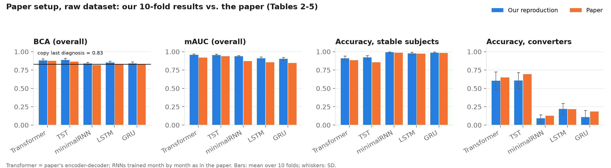
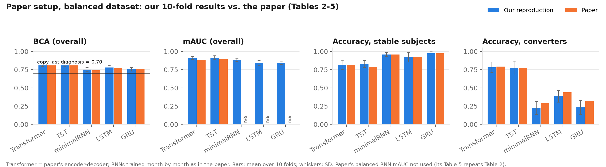
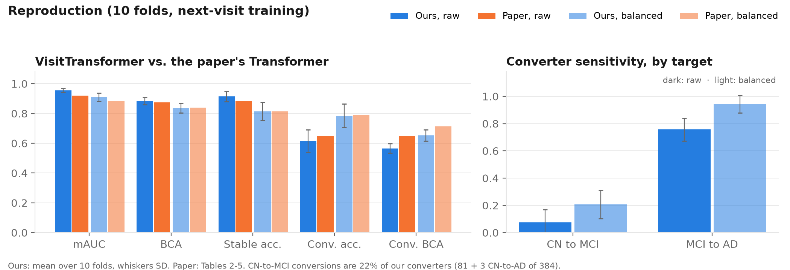
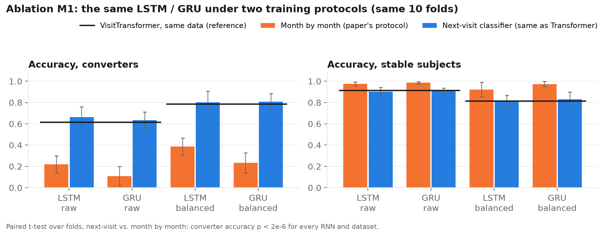
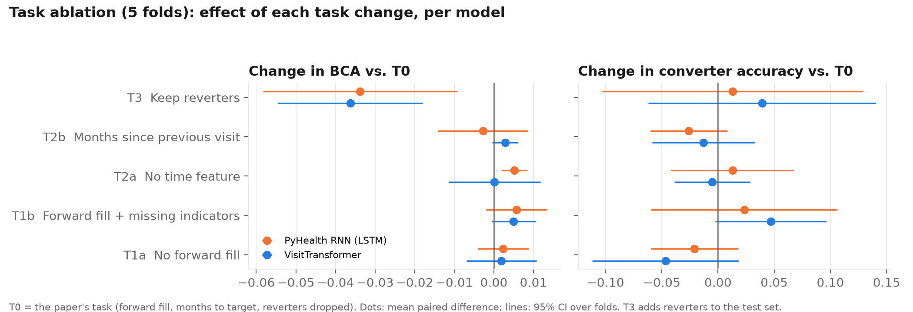
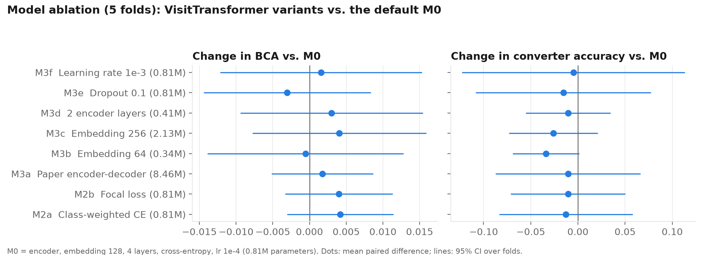

# TADPOLE AD progression: results and protocol

Results of the reproduction of Moghaddami, Schubring and Siadat,
["Transformer Model for Alzheimer's Disease Progression Prediction Using
Longitudinal Visit Sequences"](https://proceedings.mlr.press/v287/moghaddami25a.html)
(CHIL 2025), and of our ablations, run with
`examples/tadpole_ad_progression_prediction_visit_transformer.py`.

All numbers are from one run of every experiment on TADPOLE D1/D2 (code at
commit `3a77980`, one NVIDIA GH200, 305 training runs, about 2 hours with 4
processes in parallel). Paper numbers are from its Tables 2-5. This folder
holds aggregate results only; ADNI data is not redistributed.

## Summary

- **The paper's main comparison reproduces.** With the paper's own setup
  (encoder-decoder Transformer and month-by-month RNN baselines), the
  Transformer recognizes converters far better than the RNNs (accuracy .60 vs
  .09-.22 on the raw data; p < 1e-4), while the RNNs are near-perfect on
  stable subjects (.98-.99), as in the paper. Our Transformer's converter
  accuracy (.604 raw, .783 balanced) is not significantly different from the
  paper's (.648, .792; one-sample t-test p = .31 and .71), and overall BCA is
  within .01 of the paper's.
- **The gap is the training protocol, not recurrence (ablation M1).** The
  same LSTM and GRU trained as next-visit classifiers, like the Transformer,
  reach converter accuracy .64-.66 on the raw data (vs .11-.22 month by
  month; paired p < 2e-6) and show no significant difference from the
  Transformer on any metric (Welch p >= .09). With 10 folds this does not
  prove equivalence (see *Statistical tests*), but the RNNs are at most .06
  worse on converter accuracy, a small fraction of the .41-.58 that the
  training protocol changes.
- **Month-by-month RNNs mostly copy the last diagnosis.** Their overall BCA
  (.84-.85 raw) is barely above a no-training "copy last diagnosis" baseline
  (.83), but they still rank converters reasonably (T4 AUROC .74-.82).
- **Task and model ablations change little.** Apart from keeping reverters
  (-.035 BCA, because reverters enter the test set), no task change moves BCA
  by more than .006. Missing-value indicators add .047 converter accuracy for
  the Transformer (p = .06). The 8.46M-parameter encoder-decoder is not
  significantly better than a 0.34M-parameter encoder.
- **What we could not match:** converter sensitivity and BCA are lower than
  the paper's (.28 vs .43 raw), mostly because CN-to-MCI conversions are
  rarely predicted (sensitivity .07); the TST is not better than the
  Transformer (the paper reports .694 vs .648 converter accuracy).

## Why a new model

The paper's model is a Transformer over **dense visit vectors** (each visit is
a vector of measurements) with an **encoder-decoder** readout. PyHealth's
existing `pyhealth.models.Transformer` accepts dense tensors too, but it is
built for sequences of medical codes, and three of its choices do not fit
visit sequences:

| | `pyhealth.models.Transformer` | `VisitTransformer` |
|---|---|---|
| Visit order | No position encoding: the model cannot tell which visit came first | Learned position embeddings (sinusoidal in the TST) |
| Padding | The mask is inferred after a biased linear projection, so padded visits are never masked and take part in attention | Padded visits are masked out of attention, pooling and normalization, from an explicit `visits_mask` or from all-zero rows |
| Sequence summary | The first token, i.e. the **oldest** visit | Masked mean over visits (`encoder`), a learned query that attends to all visits (`encoder_decoder`), or all visit states concatenated (`tst`) |
| Architectures | Encoder only | `encoder`, the paper's `encoder_decoder` (4 encoder + 8 decoder layers), and `tst`, the paper's second Transformer baseline |
| Class imbalance | Cross-entropy | Cross-entropy, class-weighted cross-entropy, focal loss |

No PyHealth prediction model offers an encoder-decoder over visit sequences
(PromptEHR uses one to generate synthetic records) or the Time Series
Transformer, so reproducing the paper's two Transformers needs a new model.
Changing `Transformer` instead would alter the outputs of an existing model
that other tasks and examples rely on. One `VisitTransformer` class covers
the three architectures the paper compares, so they share the same masking,
input checks and losses, and differ only in the part the paper compares.

We did not benchmark PyHealth's `Transformer` on this task; the comparison
above is about design. Within `VisitTransformer`, the model ablation compares
the encoder-decoder with the smaller encoder.

## Running

Synthetic data (no ADNI access needed; the pipeline runs end to end in about
25 s on a CPU, and its numbers only show that it runs):

```bash
python examples/tadpole_ad_progression_prediction_visit_transformer.py --experiment quick
python examples/my_replication.py            # same pipeline, every experiment, synthetic
```

Real data (`TADPOLE_D1_D2.csv` from the TADPOLE challenge, ADNI access
required):

```bash
python examples/tadpole_ad_progression_prediction_visit_transformer.py \
  --root /path/to/tadpole --experiment all --device cuda --output-dir output/tadpole
```

`--experiment` is one of `reproduce`, `paper_setup`, `task_ablation`,
`model_ablation`, `all` or `quick`. `--fold k` runs one fold, so folds can run
as separate processes writing to the same directory (writes are locked).
Finished runs are skipped on restart. A run with different code, data or
settings is refused in an existing output directory, so use a new
`--output-dir` after any code change. `--summarize-only` rebuilds the
summaries, and `--audit-only` writes the cohort counts without training. The
processed caches under `--cache-dir` contain patient-level data; keep them
private.

## Data and protocol

**Cohort.** The task applies the paper's sequence rules: subjects with one
visit and reverters are dropped, visits after the first conversion and visits
without a diagnosis are discarded, and each subject gives one sequence. Two
cases the paper does not cover:

- repeated records of one exam date are merged when they agree; the subject is
  dropped when they conflict or carry different visit codes;
- transition strings such as `"MCI to NL"` count as reversions even when the
  visit diagnoses alone do not show one.

Every subject of `TADPOLE_D1_D2.csv` is accounted for (each counted under the
first rule that excludes it; `cohort.json` has the same counts):

| Step | Subjects |
|---|---|
| Subjects in TADPOLE D1/D2 | 1,737 |
| Fewer than two visits | -70 |
| Conflicting or ambiguous records on one exam date | -3 |
| Reverters (100 from the visit diagnoses, 3 more only from transition strings) | -103 |
| Fewer than two visits with a diagnosis | -18 |
| **Sequences** | **1,543** (1,159 stable, 384 converter) |

The paper reports 1,627 sequences (1,222 stable, 405 converter) but not how
many subjects each rule removes, so the gap of 84 cannot be fully explained.
Our two extra rules remove only 6 subjects, and keeping subjects with fewer
than two diagnosed visits would add at most 18 more, which leaves at least 60
sequences unexplained. Likely sources are a different release of the ADNI
data or a different reading of the reversion rule. The share of converters is
the same (24.9% in both), but the mix differs: 81 of our converters go from
CN to MCI and 3 from CN to AD (22%), against 70 CN-to-MCI conversions (17%)
in the paper.

**Balanced data.** Within each history group (number of input visits),
stable sequences are dropped at random until they match the converters, as in
the paper. One group with only converters (2 sequences) is left out, which
the paper does not specify. Result: 764 sequences (382 + 382).

**Folds.** Patient-level 10-fold cross-validation (5 folds for the
ablations), stratified by sequence type and history group (groups above 6
pooled); the same folds are used for every model, so models can be compared
fold by fold. 15% of the training patients are held out for early stopping on
validation balanced accuracy (macro recall). The paper describes a "temporal"
split with 10% of each group per test fold, without further detail.

**Training.** VisitTransformer and PyHealth's RNN: batch 32, Adam lr 1e-4,
weight decay 1e-5, up to 200 epochs, patience 20, seed 42. Month-by-month
RNNs: the settings of Nguyen et al. (100 epochs, batch 128, lr 1.29e-3).
Normalization and imputation statistics are fitted on training patients only.

**Metrics** (the paper's Section 2.5): Hand-Till mAUC, weighted F1, accuracy,
and per-subset sensitivity, specificity and BCA = (sensitivity + specificity)
/ 2. Sensitivity and specificity are one-vs-rest, averaged over CN, MCI and
AD; a class with no positives (or no negatives) in a subset counts as 0. This
reproduces the paper's Transformer converter sensitivity of 0.430 =
(0 + .645 + .645) / 3, but we could not reconcile the paper's converter
sensitivity for the RNNs (.30-.33) with their converter accuracy (.13-.22)
under any averaging, so **converter accuracy is our main converter metric**.
T4 (ours) is converter detection: among subjects not yet at AD, the AUROC of
the probability of a more severe stage than the current one.

**Missing values.** Each experiment fills missing measurements in the input
visits as follows (the target visit is never an input):

| Experiment | Models | Missing-value handling |
|---|---|---|
| `paper_setup` | Transformer (encoder-decoder), TST | "Model filling" (paper, Section 2.2): a minimalRNN trained on the fold's training patients predicts each missing value from the earlier months |
| `paper_setup` | minimalRNN, LSTM, GRU (month by month) | Inside the model, as in Nguyen et al.: a missing value is replaced by the model's own prediction for that month |
| `reproduce` | VisitTransformer, LSTM, GRU | Forward fill within the patient; values never observed before a visit get the training mean (zero after z-scoring) |
| `task_ablation` | LSTM, VisitTransformer | T0, T2, T3: forward fill. T1a: no forward fill (training mean). T1b: forward fill plus a missing-value indicator per feature |
| `model_ablation` | VisitTransformer | Forward fill (task T0) |
| all | Copy last diagnosis | Uses only the last diagnosis, which is never missing |

**Leakage checks.** Nothing fitted on data uses validation or test patients:

- *Normalization and imputation.* Every fold calls
  `dataset.set_task(task, split=...)`, which fits the z-score statistics (and
  the training means used for imputation) on the training patients only and
  applies them unchanged to validation and test. The month-by-month RNNs fit
  their standardization on the training patients too.
- *Model filling.* The minimalRNN filler is trained on the fold's training
  patients only. It fills each patient's input visits from that patient's own
  earlier inputs (at the first visit, from the first observed input value)
  and never sees the target visit. Forward fill likewise only carries values forward from
  earlier visits of the same patient.
- *Splits.* Each patient gives exactly one sequence, so splitting sequences
  is splitting patients. In every fold, training + validation + test is the
  whole cohort (1,543 raw, 764 balanced) with no overlap, and the ten test
  folds together contain every patient once.
- *Model selection.* Early stopping uses a validation set taken from the
  training patients; the test fold is only used for the final evaluation.
  Hyperparameters are fixed (the paper's where it reports them, otherwise
  one default setting), and every configuration we ran is reported.
- *Features.* The time feature ("months to the target visit") is the paper's
  design: the prediction horizon is known when a prediction is made, and it
  does not reveal the target diagnosis.

**Statistical tests.** Comparisons use Welch's t-test across folds (paired
t-tests where noted, as all models share the same folds). With 10 folds (5
for the ablations), a p-value above .05 means no difference was detected, not
that the models perform the same. Where we compare models of interest we also
give 90% confidence intervals of the difference, which show how large a
difference the data still allow.

## Reproduction: the paper's setup (10 folds)

The paper's encoder-decoder Transformer and the TST on inputs imputed by
"model filling" (a minimalRNN trained on the fold's training patients), and
the minimalRNN, LSTM and GRU trained month by month (Nguyen et al.).
`paper_setup/summary.md` has standard deviations and Welch's t-tests.

Raw dataset:

| Model | | mAUC | F1 | Acc | BCA | Stable acc | Conv. acc | Conv. BCA | Conv. sens | T4 AUROC |
|---|---|---|---|---|---|---|---|---|---|---|
| Transformer (enc.-dec.) | ours | .956 | .830 | .834 | .880 | .910 | .604 | .564 | .279 | .861 |
| | paper | .920 | .824 | .824 | .874 | .883 | .648 | .648 | .430 | – |
| TST | ours | .954 | .839 | .844 | .888 | .922 | .607 | .555 | .256 | .856 |
| | paper | .938 | .812 | .814 | .866 | .856 | .694 | .662 | .446 | – |
| minimalRNN, monthly | ours | .939 | .763 | .767 | .841 | .991 | .091 | .336 | .037 | .822 |
| | paper | .873 | .766 | .777 | .819 | .986 | .129 | .442 | .298 | – |
| LSTM, monthly | ours | .910 | .784 | .787 | .853 | .975 | .219 | .387 | .091 | .757 |
| | paper | .857 | .786 | .789 | .829 | .973 | .217 | .476 | .334 | – |
| GRU, monthly | ours | .904 | .763 | .768 | .841 | .986 | .109 | .342 | .045 | .742 |
| | paper | .846 | .786 | .792 | .830 | .984 | .184 | .464 | .320 | – |
| Copy last diagnosis | ours | .838 | .743 | .751 | .831 | 1.000 | .000 | .299 | .000 | .500 |

Balanced dataset (the paper's Table 5 repeats the raw mAUC and F1 for the
RNNs, so those cells are left out):

| Model | | mAUC | F1 | Acc | BCA | Stable acc | Conv. acc | Conv. BCA | Conv. sens | T4 AUROC |
|---|---|---|---|---|---|---|---|---|---|---|
| Transformer (enc.-dec.) | ours | .911 | .792 | .800 | .833 | .817 | .783 | .665 | .410 | .844 |
| | paper | .883 | .746 | .802 | .839 | .814 | .792 | .713 | .504 | – |
| TST | ours | .914 | .792 | .800 | .837 | .827 | .772 | .663 | .407 | .853 |
| | paper | .890 | .721 | .779 | .822 | .787 | .775 | .703 | .495 | – |
| minimalRNN, monthly | ours | .884 | .594 | .592 | .750 | .958 | .225 | .394 | .096 | .840 |
| | paper | – | – | .623 | .742 | .956 | .291 | .499 | .346 | – |
| LSTM, monthly | ours | .840 | .660 | .655 | .779 | .922 | .387 | .463 | .168 | .768 |
| | paper | – | – | .684 | .770 | .926 | .439 | .566 | .419 | – |
| GRU, monthly | ours | .844 | .606 | .603 | .756 | .974 | .233 | .396 | .098 | .826 |
| | paper | – | – | .648 | .758 | .974 | .323 | .512 | .358 | – |
| Copy last diagnosis | ours | .727 | .477 | .500 | .703 | 1.000 | .000 | .298 | .000 | .500 |




- Converter accuracy is close to the paper's for the Transformer (.604 vs
  .648, not significantly different, p = .31; balanced .783 vs .792) and
  within .00-.09 for the RNNs. Stable accuracy is within .01 for the RNNs and
  higher than the paper's for the Transformer (+.03) and the TST (+.07).
- The Transformer beats every month-by-month RNN on converter accuracy (p <
  1e-4) and BCA (p <= .014), on both datasets (Welch's t-test, 10 folds).
- mAUC is higher than the paper's for every model (by .02-.07), and so is
  overall BCA on the raw data (by .01-.02). Likely causes: our random
  patient-level folds instead of the paper's temporal split, a held-out
  validation set for early stopping, and a slightly different cohort.
- The TST and the paper's Transformer show no significant difference on any
  tested metric (p > .45); the paper reports a higher converter accuracy for the TST (.694; ours
  .607).

## Reproduction: next-visit training (10 folds)

VisitTransformer (default `encoder` architecture, 0.81M parameters) and
PyHealth's `RNN` (LSTM, GRU), all trained as next-visit classifiers on the
same folds, without model filling.

| Model | Data | mAUC | F1 | Acc | BCA | Stable acc | Conv. acc | Conv. BCA | Conv. sens | T4 AUROC |
|---|---|---|---|---|---|---|---|---|---|---|
| VisitTransformer | raw | .956 | .835 | .839 | .884 | .914 | .615 | .566 | .277 | .856 |
| LSTM (PyHealth RNN) | raw | .952 | .837 | .842 | .885 | .902 | .662 | .593 | .312 | .855 |
| GRU (PyHealth RNN) | raw | .955 | .835 | .839 | .883 | .907 | .636 | .577 | .292 | .862 |
| Copy last diagnosis | raw | .838 | .743 | .751 | .831 | 1.000 | .000 | .299 | .000 | .500 |
| Transformer (paper) | raw | .920 | .824 | .824 | .874 | .883 | .648 | .648 | .430 | – |
| VisitTransformer | balanced | .910 | .783 | .800 | .837 | .814 | .785 | .654 | .384 | .847 |
| LSTM (PyHealth RNN) | balanced | .904 | .791 | .805 | .839 | .809 | .801 | .679 | .430 | .844 |
| GRU (PyHealth RNN) | balanced | .909 | .809 | .819 | .851 | .829 | .809 | .680 | .429 | .859 |
| Copy last diagnosis | balanced | .727 | .477 | .500 | .703 | 1.000 | .000 | .298 | .000 | .500 |
| Transformer (paper) | balanced | .883 | .746 | .802 | .839 | .814 | .792 | .713 | .504 | – |



VisitTransformer reaches the paper's overall numbers (raw BCA .884 vs .874,
balanced .837 vs .839) and converter accuracy (.615 vs .648; balanced .785 vs
.792). Its converter BCA is lower: MCI-to-AD conversions are recognized well
(sensitivity .76 raw, .94 balanced) but CN-to-MCI conversions rarely (.07,
.21), and our converter subset has more of them than the paper's (22% vs
17%).

## Ablation M1: training protocol (new)

The same LSTM and GRU, on the same 10 folds, trained month by month (the
paper's baselines) or as next-visit classifiers (as the Transformer).



| | Raw: conv. acc | Raw: stable acc | Raw: BCA | Balanced: conv. acc | Balanced: BCA |
|---|---|---|---|---|---|
| LSTM, month by month | .219 | .975 | .853 | .387 | .779 |
| LSTM, next visit | .662 | .902 | .885 | .801 | .839 |
| GRU, month by month | .109 | .986 | .841 | .233 | .756 |
| GRU, next visit | .636 | .907 | .883 | .809 | .851 |
| VisitTransformer | .615 | .914 | .884 | .785 | .837 |

Next-visit training raises converter accuracy by .41-.58 (paired t-test, p <
2e-6) and BCA by .03-.09 (p <= .002), at the cost of stable accuracy (-.07 to
-.15). Trained this way, LSTM and GRU show no significant difference from
the Transformer on any metric (table below). **The paper's Transformer-vs-RNN gap comes from how the baselines are
trained**: month-by-month forecasting mostly keeps the current diagnosis
(CN-to-MCI sensitivity 0 and MCI-to-AD .27 for the LSTM on the raw data).

Next-visit RNNs vs. VisitTransformer on every metric (10 folds; Δ = RNN minus
VisitTransformer, with its 90% confidence interval and Welch's t-test):

Raw dataset:

| Metric | VisitTransformer | LSTM | Δ LSTM (90% CI) | p | GRU | Δ GRU (90% CI) | p |
|---|---|---|---|---|---|---|---|
| mAUC | .956 | .952 | -.003 [-.015, +.009] | 0.64 | .955 | -.001 [-.012, +.010] | 0.87 |
| F1 | .835 | .837 | +.002 [-.030, +.034] | 0.91 | .835 | +.001 [-.028, +.029] | 0.98 |
| Accuracy | .839 | .842 | +.003 [-.026, +.032] | 0.88 | .839 | +.000 [-.026, +.026] | 1.00 |
| BCA | .884 | .885 | +.001 [-.018, +.020] | 0.93 | .883 | -.001 [-.019, +.017] | 0.94 |
| Stable acc. | .914 | .902 | -.012 [-.042, +.018] | 0.50 | .907 | -.007 [-.033, +.019] | 0.65 |
| Conv. acc. | .615 | .662 | +.047 [-.025, +.119] | 0.27 | .636 | +.021 [-.041, +.083] | 0.57 |
| Conv. BCA | .566 | .593 | +.027 [-.007, +.062] | 0.19 | .577 | +.011 [-.014, +.037] | 0.45 |
| Conv. sens. | .277 | .312 | +.035 [-.011, +.080] | 0.20 | .292 | +.015 [-.019, +.050] | 0.45 |
| T4 AUROC | .856 | .855 | -.001 [-.037, +.035] | 0.97 | .862 | +.006 [-.027, +.040] | 0.74 |

Balanced dataset:

| Metric | VisitTransformer | LSTM | Δ LSTM (90% CI) | p | GRU | Δ GRU (90% CI) | p |
|---|---|---|---|---|---|---|---|
| mAUC | .910 | .904 | -.006 [-.029, +.016] | 0.62 | .909 | -.002 [-.025, +.022] | 0.90 |
| F1 | .783 | .791 | +.008 [-.049, +.065] | 0.82 | .809 | +.025 [-.024, +.075] | 0.39 |
| Accuracy | .800 | .805 | +.005 [-.045, +.056] | 0.86 | .819 | +.020 [-.026, +.065] | 0.46 |
| BCA | .837 | .839 | +.002 [-.032, +.035] | 0.93 | .851 | +.014 [-.018, +.045] | 0.46 |
| Stable acc. | .814 | .809 | -.005 [-.055, +.044] | 0.85 | .829 | +.015 [-.038, +.068] | 0.62 |
| Conv. acc. | .785 | .801 | +.016 [-.061, +.093] | 0.73 | .809 | +.024 [-.040, +.087] | 0.52 |
| Conv. BCA | .654 | .679 | +.025 [-.017, +.068] | 0.32 | .680 | +.026 [-.006, +.058] | 0.17 |
| Conv. sens. | .384 | .430 | +.046 [-.013, +.106] | 0.19 | .429 | +.046 [+.002, +.089] | 0.09 |
| T4 AUROC | .847 | .844 | -.002 [-.046, +.041] | 0.92 | .859 | +.012 [-.031, +.055] | 0.64 |

No difference is significant at .05. The intervals are narrow for mAUC and
overall BCA (within about ±.035) but wide for the converter metrics (up to
±.08), so the data rule out a large Transformer advantage on converters
without proving that the models are equivalent.

**Copy-last baseline and T4.** Predicting the last input diagnosis gives BCA
.831 (raw) and .703 (balanced) with no training; the month-by-month RNNs are
only .01-.02 (raw) and .05-.08 (balanced) above it. Their converter-detection
AUROC (minimalRNN .82, LSTM .76, GRU .74) is well above chance, so they do
rank converters; their decision threshold rarely flips the diagnosis.

## Task ablation (new; 5 folds)

Each task change, run with PyHealth's existing `RNN` (LSTM) and with
VisitTransformer on the same folds. T0 is the paper's task: forward fill,
months to the target visit as the time feature, reverters dropped.

| Configuration | LSTM: BCA | LSTM: Conv. acc | LSTM: T4 AUROC | Transformer: BCA | Transformer: Conv. acc | Transformer: T4 AUROC |
|---|---|---|---|---|---|---|
| T0 paper task (default) | .878 | .625 | .860 | .882 | .625 | .851 |
| T1a no forward fill | .881 | .604 | .845 | .884 | .578 | .846 |
| T1b forward fill + missing indicators | .884 | .648 | .859 | .887 | .672 | .852 |
| T2a no time feature | .883 | .638 | .853 | .883 | .620 | .857 |
| T2b months since previous visit | .875 | .599 | .853 | .885 | .612 | .845 |
| T3 keep reverters | .845 | .638 | .851 | .846 | .664 | .853 |



- **T1 missing data.** Without forward fill, converter accuracy drops by .02
  (LSTM) and .05 (Transformer). Adding missing-value indicators raises it by
  .02 and .05 (Transformer p = .06) and BCA by .005; the most promising change
  we found.
- **T2 time feature.** Removing it, or replacing "months to target" by
  "months since the previous visit" (which does not reveal how far ahead the
  target is), changes BCA by at most .005: the visit sequence carries the
  information.
- **T3 label definition.** Keeping reverters lowers BCA by .035 (p <= .02)
  for both models, because the test set then contains reverters, of which the
  models get only 28% right: they rarely predict an improving diagnosis.
- The two models respond in the same direction to every change, and under
  every configuration their BCA and converter accuracy show no significant
  difference (paired p >= .07).

## Model ablation (new; 5 folds, VisitTransformer, task T0)

| Configuration | Params | BCA | Stable acc | Conv. acc | Conv. sens | T4 AUROC |
|---|---|---|---|---|---|---|
| M0 default: encoder, d128, 4 layers, CE, lr 1e-4 | 0.81M | .882 | .909 | .625 | .276 | .851 |
| M2a class-weighted cross-entropy | 0.81M | .887 | .921 | .612 | .272 | .850 |
| M2b focal loss | 0.81M | .886 | .919 | .614 | .262 | .847 |
| M3a paper encoder-decoder (d256, 4 heads, 4+8 layers) | 8.46M | .884 | .915 | .614 | .282 | .861 |
| M3b embedding 64 | 0.34M | .882 | .918 | .591 | .250 | .853 |
| M3c embedding 256 | 2.13M | .886 | .923 | .599 | .260 | .857 |
| M3d 2 encoder layers | 0.41M | .885 | .917 | .615 | .265 | .850 |
| M3e dropout 0.1 | 0.81M | .879 | .911 | .609 | .282 | .854 |
| M3f learning rate 1e-3 | 0.81M | .884 | .915 | .620 | .305 | .859 |



No variant differs from the default by more than .005 BCA (paired p >= .18).
The paper's encoder-decoder (8.46M parameters here; the paper reports 6.60M
with an unreported feed-forward width) is not significantly better than a 0.34M-parameter
encoder on 1,543 sequences. Class-weighted and focal losses do not raise
converter accuracy. T0 and M0 are the same configuration and give identical
numbers, which confirms that runs are deterministic for a given seed and
split.

## Files

| Path | Contents |
|---|---|
| `cohort.json` | Cohort counts: exclusions, sequence types, history groups, transitions |
| `<experiment>/summary.md` | Table of means ± SD with valid folds, Welch's t-tests |
| `<experiment>/summary.csv` | Every metric: mean, SD and valid folds per configuration |
| `<experiment>/runs.jsonl` | One line per configuration and fold: all metrics, split sizes, a hash of the split |
| `<experiment>/manifest.json` | Code version, package versions, settings and data fingerprint |
| `<experiment>/cohort_*.json` | Cohort counts for that experiment's datasets |
| `figures/` | The figures above |

`<experiment>` is `reproduce`, `paper_setup`, `task_ablation` or
`model_ablation`.
